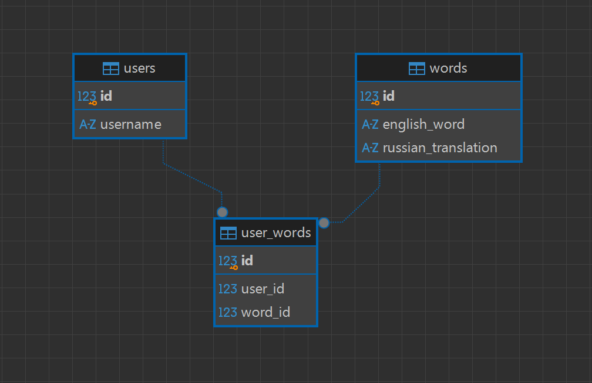

# EnglishCard

Приложение на Python для изучения английских слов. Пользователь может добавлять собственные слова в словарь и удалять их

## Возможности

- Регистрация пользователя по имени.
- Персональный словарь для каждого пользователя.
- 10 общих слов доступны всем пользователям.
- Добавление собственных английских слов и переводов.
- Удаление слов из личного словаря.
- Тренировка с четырьмя вариантами перевода.
- Две попытки на каждый вопрос.
- Отображение количества слов в словаре.

## Схема базы данных


## Установка и запуск

1. Клонирование проекта
```bash
git clone https://github.com/Malysheva-Anna/EnglishCard
cd EnglishCard
```

2. Установка зависимостей
```bash
python -m pip install -r requirements.txt
```

3. Настройка подключения к PostgreSQL. Создайте файл .env в корневой папке проекта по образцу .env.example. Укажите собственные параметры подключения к PostgreSQL:
```bash
DB_NAME=englishcard
DB_USER=postgres
DB_PASSWORD=your_password
DB_HOST=localhost
DB_PORT=5432
```

4. Создание базы данных и таблиц. Скрипт создаст базу данных englishcard, необходимые таблицы и добавит начальные слова. Выполните команду:
```bash
python init_db.py
```


5. Запуск приложения
```bash
streamlit run main.py
```

После запуска приложение откроется в браузере